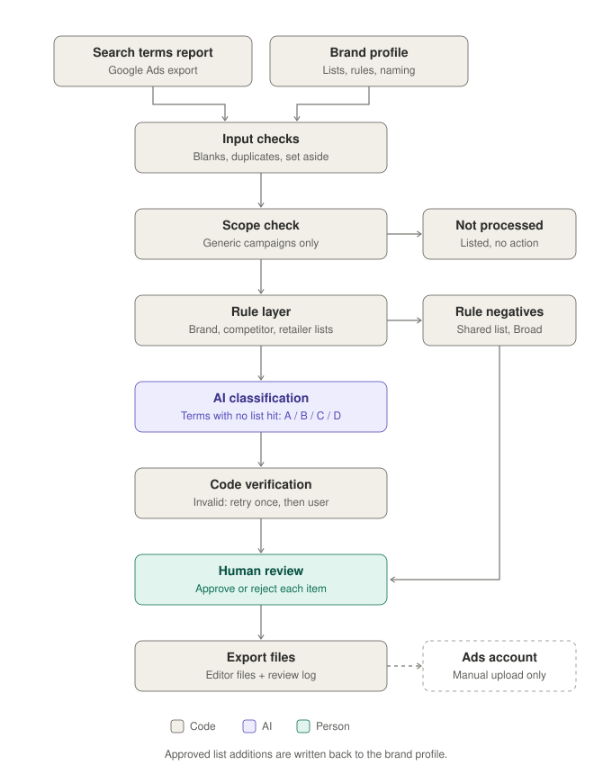

# SQR Agent (prototype)

Turns a Google Ads search terms report into negative-keyword and new-keyword suggestions that a person reviews and approves, then exports files for Google Ads Editor. The agent never connects to or changes an ad account.



**How it works.** Code does everything that can be decided by rules: it checks the input, keeps only generic campaigns, and matches the brand, competitor and retailer lists. Only the terms no rule can decide go to the AI, which judges product relevance (A: fits this ad group, B: belongs in another ad group, C: too broad, D: unrelated). Code then verifies every AI answer, a person approves or rejects every suggestion, and the agent exports files for Google Ads Editor. Uploading them to the account is done by a person.

Status: **prototype, stages 1–3 of 5**. Built and tested so far:

- `src/legacy.js`: code reproduction of the original SQR Excel template (columns E, G, H, I).
  `npm run parity` compares it with the template's own results: 225 rows × 4 columns, 0 mismatches.
- `src/input.js` + `shared/tabular.js`: reads the report as downloaded from Google Ads (CSV/TSV, UTF-8/UTF-16, title lines, total rows) and sets aside rows it cannot process, with reasons.
  `npm run check` runs it on the demo export.
- `profiles/dewalt.json` + `src/profile.js`: the brand profile (lists, campaign naming, rule settings) and its validation. The code contains no brand names.
- `shared/match.js` + `src/rules.js`: the rule layer. Matches brand, competitor and retailer lists on the original search term in any language, and turns hits into negative suggestions. Terms without a hit are queued for the AI (stage 3).
  `npm run rules` prints the suggestions for the demo export.
- `src/diff.js`: old template vs new rules, row by row. `npm run diff` writes `docs/reports/legacy-vs-new.md`.
- `src/classify.js` + `src/prompts.js` + `shared/llm.js`: the AI step. Classifies the remaining terms (A–D), translates them and proposes list additions; code verifies every answer. `src/suggest.js` turns everything into review items (all undecided).
  `npm run classify` needs an API key in `.env` (see `.env.example`) and writes `runs/<time>.json`.
- `src/eval.js`: AI accuracy against analyst labels. Fill in `data/eval/nl-labels.csv`, then `node src/cli.js eval runs/<time>.json data/eval/nl-labels.csv`.

Requirements: Node.js 20.6+. No dependencies.

```
npm test          # all tests
npm run parity    # legacy reproduction vs the Excel template
npm run check     # input checks on data/demo/nl-search-terms-export.csv
npm run rules     # rule layer on the demo export
npm run diff      # old vs new classification report
```

Data: `data/legacy/` holds the original template and the extracted snapshot (`scripts/extract-legacy-fixture.py`, needs Python + openpyxl). `data/demo/` holds an export-style file built from the template rows (`scripts/build-demo-export.js`). The template contains no performance data, so the demo file has none.

Design decisions and findings: `docs/DESIGN.md`.
